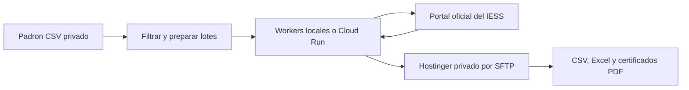

# WEBSR — padrón SRI y consultas IESS

Filtra contribuyentes activos del padrón SRI, consulta el certificado de obligaciones patronales del IESS y conserva resultados verificables en CSV, Excel y PDF. Incluye ejecución local y Docker para Cloud Run Jobs.

Los importes se extraen del certificado del RUC consultado. Son el monto de mora informado en la fecha de consulta; el certificado no ofrece un desglose de capital e intereses. `RUC_RECHAZADO_IESS` significa que el portal rechazó el RUC y no determina su estado de deuda.

## Destino del despliegue: Cloud Run Jobs

Este contenedor ejecuta tareas por lotes. El destino es **Cloud Run → Jobs**, con `kind: Job` y comandos `gcloud run jobs ...`. No proporciona una URL web ni escucha el puerto 8080.

Si el log muestra `gcloud run services.update`, `Creating Revision` y el error de `PORT=8080`, el trigger está desplegando un **Service**. Corregir el puerto o ampliar el timeout no cambia el tipo de proceso del contenedor.

### Corregir un trigger automático de GitHub

1. Abre **Cloud Build → Triggers** y edita el trigger de este repositorio que despliega el servicio.
2. En configuración del build, elige **archivo de configuración de Cloud Build** del repositorio y la ruta `/cloudbuild.yaml`. La configuración inline generada para el servicio no utiliza este archivo automáticamente.
3. Desde un equipo con tus `.env`, obtén los valores que debes poner en las sustituciones del trigger:

   ```bash
   .venv/bin/python -m cloudrun.build_job --phase companias --mode pilot --print-substitutions
   ```

   Son metadatos de conexión y del job. La contraseña no se imprime: el YAML sigue referenciando Secret Manager.

4. Asegura que ya ejecutaste `bash cloudrun/deploy.sh setup`. El repositorio de imágenes, la cuenta `iess-worker` y el secreto SFTP deben existir.
5. La cuenta que ejecuta Cloud Build necesita escribir imágenes en Artifact Registry, administrar Jobs de Cloud Run y actuar como la cuenta de servicio del job. Puedes asignarle `roles/artifactregistry.writer` en el repositorio, `roles/run.developer` en el proyecto y `roles/iam.serviceAccountUser` en la cuenta del job. Si usas Cloud Logging con una cuenta personalizada, necesita `roles/logging.logWriter`.
6. Ejecuta el trigger. El último paso debe ser `gcloud run jobs replace`, y el recurso debe aparecer en **Jobs** como `iess-companias-piloto`.

El pipeline construye, publica la imagen y crea o actualiza el Job. **No inicia consultas al IESS por cada push.** Antes de ejecutarlo deben estar subidos los manifiestos y lotes privados. Luego:

```bash
gcloud run jobs execute iess-companias-piloto --project TU_PROYECTO --region TU_REGION --wait
```

### Ejecutar el mismo pipeline desde terminal

```bash
git pull --ff-only
gcloud auth login
bash cloudrun/deploy.sh setup
bash cloudrun/deploy.sh ci companias pilot
```

Ese comando usa la configuración local para llenar las sustituciones y desplegar el Job piloto. Puede construir el piloto antes de preparar los lotes; no podrá consultarlos hasta que los hayas preparado y subido con los pasos de migración de abajo. Para desplegar la fase completa:

```bash
bash cloudrun/deploy.sh ci companias full
```

El modo completo requiere el manifiesto local y obtiene de él el número exacto de tareas. Al terminar el build, el job queda creado y lo ejecutas con `bash cloudrun/deploy.sh run companias`. No elimines un servicio existente sin revisar antes qué otras funciones tenga; el Job puede crearse por separado.

## Instalación

```bash
python3 -m venv .venv
.venv/bin/python -m pip install -r requirements.txt
cp .env.example .env
cp cloudrun/.env.example cloudrun/.env
```

Completa `.env` con el acceso SFTP de tu Hostinger y `cloudrun/.env` con el proyecto Google Cloud. Los archivos de configuración reales, padrones, resultados y certificados están excluidos de Git. Copia por separado tus carpetas locales `rucs/` y `salida/` si cambias de equipo.

Para partir del padrón original, extrae su CSV como `padron_guayas.csv` y ejecuta:

```bash
.venv/bin/python filtrar_padron.py padron_guayas.csv --todo-guayas
.venv/bin/python -u ejecutar_consultas.py
```



## Almacenamiento privado en Hostinger

```bash
.venv/bin/python -m hostinger.admin init
```

La primera conexión SSH fija la huella del servidor en tu `.env`; las siguientes conexiones la comprueban. Puedes contrastarla con la que muestra el panel de Hostinger. El almacén se crea en `~/websr-data`, fuera de `public_html`, con acceso restringido al usuario SSH. Las variables antiguas `FTP_REMOTE_PATH` y `FTP_PUBLIC_URL` no se utilizan para publicar información de contribuyentes.

SFTP transfiere los archivos. Un pequeño script PHP, instalado también fuera de la web, coordina las escrituras por SSH mediante `flock`, versiones y reemplazos atómicos. Así, varios workers comparten el control de tráfico sin sobrescribir resultados. Se necesita SSH/SFTP y PHP CLI 8 o superior.

Los resultados por RUC se agrupan en paquetes JSON para reducir el número de archivos del hosting. Los certificados PDF sí son archivos individuales; revisa el espacio y la cuota de archivos disponibles en tu plan antes de procesar todo el padrón.

### CSV y Excel que se actualizan durante la corrida local

Después de autorizar la transferencia de los datos a tu servidor:

```bash
.venv/bin/python -m hostinger.sync_local --watch --interval 60
```

Se actualizan estos archivos privados:

```text
~/websr-data/objects/
  exports/local/companias/checkpoint_companias.csv
  exports/local/companias/deudores_companias.xlsx
  exports/local/personas/checkpoint_personas.csv
  exports/local/personas/deudores_personas.xlsx
  exports/local/resumen.json
  archives/companias/<RUC>.pdf
  archives/personas/<RUC>.pdf
```

El intervalo se cuenta entre sincronizaciones terminadas; una transferencia puede tardar más de un minuto. Los certificados ya enviados se reutilizan. El sincronizador termina cuando detecta que la corrida local se detuvo. Mientras uses esta opción, el equipo local debe permanecer encendido. Puedes descargar CSV, Excel y PDF con FileZilla/SFTP; no tienen un enlace web público.

Para este volumen, los archivos son el registro principal y Excel es una vista para revisión. Google Sheets puede servir posteriormente para un resumen; no hace falta que cada consulta dependa de escribir en una hoja compartida.

## Cloud Run con Hostinger

El valor recomendado es `STORAGE_BACKEND=sftp` en `cloudrun/.env`. Google Cloud ejecuta el contenedor y Hostinger conserva lotes, avance, certificados y reportes. No se necesita un bucket GCS para este modo. `STORAGE_BACKEND=gcs` conserva la opción anterior.

```bash
gcloud auth login
bash cloudrun/deploy.sh setup
bash cloudrun/deploy.sh build
```

`setup` configura una cuenta de servicio y carga la contraseña SFTP en Secret Manager. El YAML referencia ese secreto; no incluye su valor. La cuenta del job recibe acceso a ese secreto. No copies `.env` ni contraseñas a Docker o a GitHub.

Cuando decidas migrar, detén el proceso local y toma su avance:

```bash
.venv/bin/python -m cloudrun.pause_local
bash cloudrun/deploy.sh prepare
bash cloudrun/deploy.sh upload
bash cloudrun/deploy.sh pilot companias
```

El piloto consulta hasta 20 RUC pendientes. Después de revisar su ejecución:

```bash
bash cloudrun/deploy.sh deploy companias
bash cloudrun/deploy.sh run companias
```

Cuando termine compañías, repite `pilot`, `deploy` y `run` para `personas`. Los YAML con los valores reales quedan en `cloudrun/rendered/`. La plantilla está en [`cloudrun/job.yaml`](cloudrun/job.yaml).

### Ritmo de consulta y reanudación

- Dos tareas simultáneas al inicio, una consulta a la vez dentro de cada tarea.
- Un regulador compartido entre todas las tareas limita también los GET de formulario.
- Empieza con un comienzo de petición cada cuatro segundos. Después de cada 100 respuestas correctas reduce el intervalo gradualmente, hasta un mínimo global de un segundo más un pequeño margen aleatorio.
- HTTP 429/5xx aumentan la espera y respetan `Retry-After`. Tres errores sin completar otra ventana saludable detienen nuevas consultas.
- HTTP 401/403, CAPTCHA, redirecciones o respuestas desconocidas requieren revisión manual. No se intenta eludir restricciones del portal.
- Se guarda cada respuesta antes de continuar. Los lotes completados se omiten al reejecutar y los parciales retoman los resultados confirmados.

Esta configuración reduce el tráfico y permite frenarlo; no garantiza que IESS acepte la automatización ni que nunca imponga restricciones. Aumentar contenedores no elimina el límite global. Cambiar `PARALLELISM` afecta las ejecuciones nuevas del job.

```bash
.venv/bin/python -m cloudrun.control status --storage sftp
.venv/bin/python -m cloudrun.control pause --storage sftp
# Después de revisar el problema y terminar la espera del portal:
.venv/bin/python -m cloudrun.control resume --storage sftp
bash cloudrun/deploy.sh run companias
```

Cada tarea usa 1 vCPU, 1 GiB y un máximo de seis horas. El tiempo de espera de las tareas también se factura. Si se interrumpe una tarea, los resultados confirmados permanecen guardados; una respuesta aún no guardada puede requerir repetir esa consulta.

### Reportes de Cloud Run

Los CSV por lote se actualizan cada 50 RUC y al terminar. En modo Hostinger, una tarea a la vez actualiza el CSV y Excel consolidados aproximadamente cada 15 minutos mientras haya actividad y al finalizar un lote. Una interrupción del exportador puede dejar el consolidado atrasado; los JSON y CSV del lote permanecen como respaldo.

```bash
bash cloudrun/deploy.sh collect companias
bash cloudrun/deploy.sh collect personas
```

`collect` genera archivos locales en `cloudrun/downloads/` y actualiza la copia privada en `objects/exports/cloudrun/DATASET/FASE/`. En modo SFTP no necesita credenciales ADC de Google. Para dar por terminada una fase, revisa que el resumen indique cero pendientes y ejecuta una consolidación final.

## Pruebas

```bash
.venv/bin/python -m pip install -r cloudrun/requirements-dev.txt
.venv/bin/python -m unittest discover -s cloudrun/tests -v
docker build -t websr:local .
```

Las pruebas no consultan el portal del IESS. Las pruebas de coordinación PHP usan archivos temporales locales; requieren PHP CLI y un entorno Linux bajo `/home`.

## Referencias

- [Consulta oficial de obligaciones patronales del IESS](https://www.iess.gob.ec/empleador-web/pages/morapatronal/certificadoCumplimientoPublico.jsf)
- [Cloud Run Jobs](https://docs.cloud.google.com/run/docs/create-jobs)
- [SFTP en Hostinger](https://www.hostinger.com/support/5972689-how-to-connect-to-your-hosting-using-sftp-in-hostinger/)
- [Bloqueos de archivos PHP](https://www.php.net/manual/en/function.flock.php)

`cloudrun/LEEME.txt` conserva las instrucciones del modo GCS anterior. Para Hostinger sigue este README.
